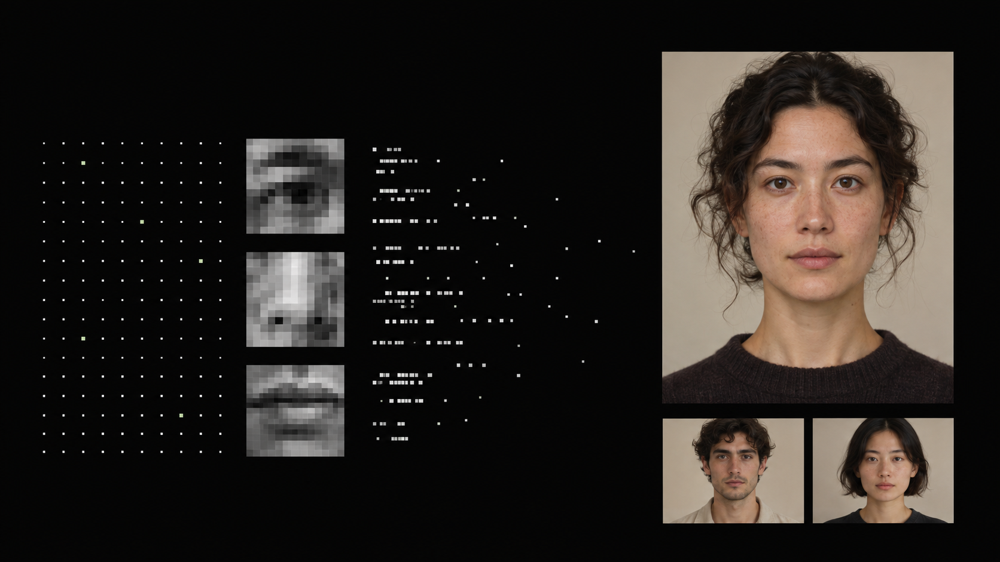
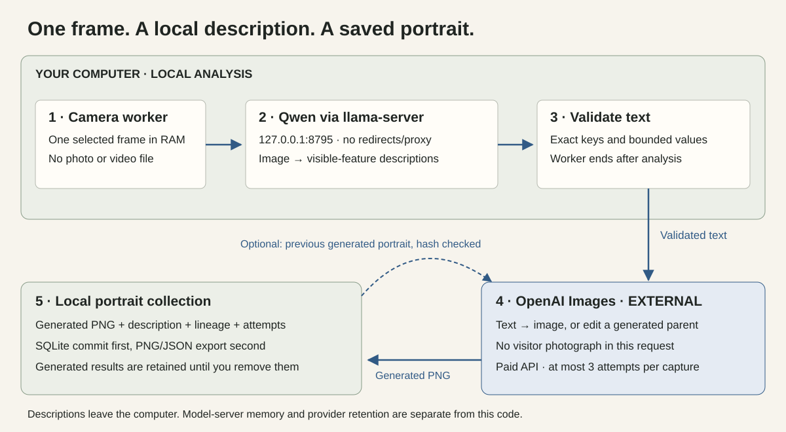

# Portrait Seed

**This repository is pre-packaged for an AI coding agent. Give the agent its GitHub link or this ZIP and ask it to read [AGENTS.md](AGENTS.md): it will have a step-by-step setup plan, verification commands, and clear points where you supply model files, an API key, and permission to use the camera or make a paid request.**



A small Python core that turns one frame from a local camera into a fictional portrait through a locally generated description. It can use its previous generated portrait as the starting point for the next image and keeps every successful result.

There is no website, dashboard, video preview, sound engine, installation renderer or face-recognition memory. The terminal commands below are thin entry points into reusable Python modules.

[Setup](docs/SETUP.md) · [Guide in Romanian](docs/GHID-RO.md) · [Data flow](docs/PRIVACY.md) · [Source provenance](docs/PROVENANCE.md) · [Publish this repository](PUBLISH.md)

## What the code does

1. Read a short camera warm-up and select one frame, without saving video or a photograph.
2. Send that frame to **Qwen on `127.0.0.1`**, through a separately installed local `llama-server`.
3. Validate a bounded JSON description of selected visible features.
4. End the camera/analysis worker. Only validated text reaches the main process.
5. Send the description to the OpenAI Images API. For subsequent portraits, include only a previous generated image retrieved from this project's own result database.
6. Commit the generated PNG and metadata locally. Export a PNG and JSON sidecar into the private collection.



The photographs are not the input to the cloud image endpoint. **Descriptions do leave the device**, and a generated reference image does too when continuing a portrait. Descriptions can contain personal information. Source code makes this boundary inspectable; it is not a certification of an installed computer or of a third-party provider's policies.

## Start with an AI agent

Copy this instruction with the repository link or ZIP:

> Read AGENTS.md and docs/SETUP.md. Help me set up Portrait Seed on this computer. First inspect my OS and available resources, then run the offline tests. Explain the model files and API access I need. Do not ask me to paste secrets into chat. Ask before opening the camera or making a chargeable call. Keep source photographs local, preserve the three-attempt limit, and guide me through one saved portrait before suggesting extensions.

An agent with local terminal access can carry out the steps. An agent that can only read the repository can explain them for you to run. Dependencies, model downloads and API access still require a working network and suitable hardware.

## Quick start

Requires Python 3.11 or newer, a local OpenCV-compatible camera, a local vision-language model server, and your own OpenAI API access. Windows and Linux setup commands are in [SETUP.md](docs/SETUP.md).

```sh
python -m venv .venv
# Activate .venv as described in SETUP.md, then:
python -m pip install -e .
python -m unittest discover -s tests -v
```

Download the Qwen model and its matching multimodal projector separately; start them on loopback using the instructions in [SETUP.md](docs/SETUP.md). No automatic model downloads occur in this package.

```sh
# Check the local model service; no camera or cloud request.
python -m portrait_seed doctor

# Capture once and create a local description; no OpenAI call.
python -m portrait_seed describe --camera 0 --consent

# After setting OPENAI_API_KEY privately, submit the printed job ID.
python -m portrait_seed resume JOB_ID --allow-paid

# Or perform both stages for a new capture:
python -m portrait_seed generate --camera 0 --consent --allow-paid
```

`--consent` is your acknowledgement that the participants agreed; it is not a consent-management system. `--allow-paid` permits **up to three total image attempts for that capture**, including retries after a lost response. Repeated attempts may each be charged. Stop/restart does not reset that budget. No new cloud request starts more than ten minutes after the frame was captured.

An in-flight image request may finish after that deadline. The local analysis worker is limited to ten minutes including camera startup; raw frames are never intentionally written to disk by this package. The model server, OS memory, swap and crash dumps have separate lifecycles. See [PRIVACY.md](docs/PRIVACY.md).

## Saved results

```text
private-data/                  # never publish or commit this directory
  portraits.sqlite3            # descriptions, attempts, generated PNGs, lineage
  portraits/
    <job-id>.png               # generated portrait
    <job-id>.json              # description, timestamps, parent, hash, attempts
```

```sh
python -m portrait_seed list
python -m portrait_seed export JOB_ID
# Use a new private directory to start a separate portrait lineage:
python -m portrait_seed --data another-private-directory generate --consent --allow-paid
```

Completed images and descriptions have **no automatic expiry**. Keep them outside public repositories and cloud-synced folders unless you intentionally choose otherwise. Removing an exported PNG alone does not remove the generated image stored in SQLite.

## Read the core

| File | Responsibility |
| --- | --- |
| [capture.py](src/portrait_seed/capture.py) | Local device only, short-lived worker, hard parent-side timeout |
| [local.py](src/portrait_seed/local.py) | Fixed loopback analysis endpoint, no proxy or redirects |
| [prompts.py](src/portrait_seed/prompts.py) | Visible-feature prompt, strict description schema, fictional-portrait prompt |
| [cloud.py](src/portrait_seed/cloud.py) | Fixed OpenAI image endpoint, text and generated reference only |
| [pipeline.py](src/portrait_seed/pipeline.py) | Bounded retries, no paid retry caused by a save failure |
| [store.py](src/portrait_seed/store.py) | Durable attempt counts, image checksums and retained portraits |
| [tests](tests) | Offline checks of requests, failure paths and persistence |

The default is `gpt-image-1-mini`, low quality, 1024 × 1536. This is a reproducible starting configuration, not a claim that every account has access or that models produce identical results. OpenAI availability and charges depend on your account. The local model's descriptions can also be wrong.

## Origin and full article

This is a standalone adaptation of the generation path used in **Feature Fusion — The Face Between Us**, a participatory installation by Deian Berar. It preserves the local-description approach while deliberately excluding the exhibition's interface, sound, visualization and identity-memory systems. It is not the full installation or a byte-for-byte copy of its runtime.

Read the full project article at [SIDECUBE — Feature Fusion](https://sidecube.ro/revista/feature-fusion/). The generic repository is intended for study and reuse independently of that exhibition.

## License and illustration

Code: [MIT](LICENSE), copyright Deian Berar. External libraries, downloaded model files and API services retain their own licenses and terms.

The overview is an AI-generated conceptual illustration, not a camera capture or a pipeline benchmark. The data-flow drawings are authored SVG diagrams of the code. Details and generation prompt: [ILLUSTRATIONS.md](docs/ILLUSTRATIONS.md).

