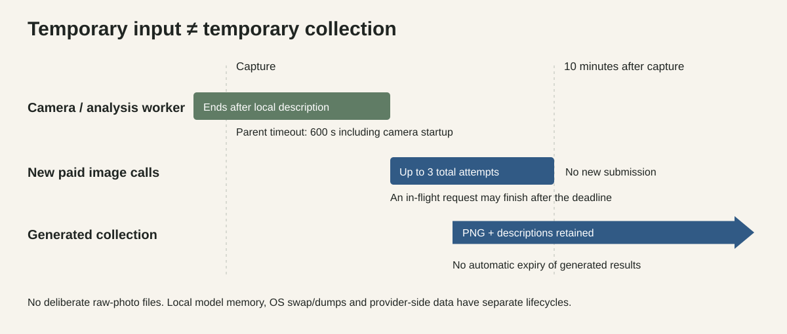

# Inspect the data boundary

The design goal is narrow and verifiable: **the camera photograph is used only
for local visual analysis; the cloud image call receives validated descriptions
and optionally a previous generated portrait.** It is not an entirely offline
generator and does not make every derived description anonymous.

## What goes where

| Data | Location and use | Retention in this project |
| --- | --- | --- |
| Warm-up frames and selected camera frame | OpenCV worker memory | No video/photo file is written; worker exits after analysis or is terminated at the timeout |
| Resized JPEG | Request to `127.0.0.1:8795` only | Python worker is terminated; local model server has its own memory lifecycle |
| Validated visual descriptions | Main process, SQLite, OpenAI prompt, JSON sidecars | Retained with generated results; no automatic deletion |
| Previous generated portrait | SQLite and OpenAI image-edit request | Retained, with SHA-256 checked before reuse |
| Generated result | Provider response, SQLite, local PNG | Retained until explicitly removed |
| Face embeddings, names, visitor identity profiles | Not implemented | Not created by this package |
| API credential | Process environment and OpenAI client | Not intentionally logged or saved by the package |

## Where to check in code

1. [capture.py](../src/portrait_seed/capture.py): `VideoCapture` takes a numeric
   local device index. There is no `imwrite`, video recorder, upload or GUI.
   `_worker` sends only a timestamp and validated description over its pipe.
   The parent uses a spawn process and terminates it on completion or timeout.
2. [local.py](../src/portrait_seed/local.py): the only camera-image request has a
   fixed loopback URL. Environment proxies and redirects are disabled. No hosted
   vision fallback exists. Response size and schema are bounded.
3. [prompts.py](../src/portrait_seed/prompts.py): the model is asked to describe
   visible appearance only. Descriptions have exact keys, a visibility enum,
   length limits and no URL/data-URI payloads. Validation is structural; it cannot
   establish that the words are true or free of personal information.
4. [cloud.py](../src/portrait_seed/cloud.py): initial generation is text-only.
   Editing requires a `GeneratedReference`, not arbitrary bytes or an input path.
   Its bytes come from a completed database record through `Store.reference()`.
   The provider URL is fixed; proxy/redirect use and SDK retries are disabled.
5. [store.py](../src/portrait_seed/store.py): SQLite stores descriptions and
   generated images, never the capture. Attempts are committed before dispatch.
   A checksum detects accidental modification of the reference image.
6. [tests/test_core.py](../tests/test_core.py): intercepted real SDK HTTP requests
   assert the allowed destinations and payloads; tests cover redirects, malformed
   output, expired jobs, capped retries, restart and failed exports.

## Ten-minute boundary

The parent bounds camera startup plus local analysis to at most 600 seconds.
Photograph bytes are not deliberately persisted and disappear from the worker's
reachable process memory when it exits. A pending job stores only its text.
Its cloud-submission deadline is capture time plus 600 seconds and is not renewed
by resume. A request already submitted may finish after expiry.

This does **not** promise secure erasure of physical RAM, swap, OS dumps, camera
driver buffers or memory inside the separately running local model server.
Prompt caching is disabled in both the request and the documented server launch,
but disabling caching is not a forensic erasure guarantee. For a sensitive
deployment, review the OS, local model logging and server lifecycle as well.

## What source code can and cannot prove

These files and tests provide inspectable evidence of the intended application
flow. The tests use synthetic images and mock HTTP transports; they are not an
independent audit of a deployed installation. A hash manifest detects accidental
package changes, not authenticity or the behavior of modified dependencies.

Python types and hashes prevent common mistakes; they are not an isolation
boundary against someone who controls the computer, edits the code, fabricates a
database, monkey-patches functions or substitutes the process listening on the
local port. Use trusted dependencies and a private local data directory.

OpenAI receives descriptions, generated references and normal request metadata.
Provider-side retention/training settings are governed separately by the account
and service. This package does not verify them and makes no zero-retention or
legal-compliance claim. Review [OpenAI data controls](https://developers.openai.com/api/docs/guides/your-data)
for your own account before use.

The original installation additionally has identity memory and an interface.
Those components are absent here. Do not infer the installation's complete
privacy behavior from this reduced repository; see [PROVENANCE.md](PROVENANCE.md).

## Deleting the collection

Stop commands that use the data directory. Generated images are stored in both
SQLite and exported PNGs; descriptions are in SQLite and JSON sidecars. To remove
the whole collection, remove the private data directory and any backups you made.
The default name is `private-data`. This does not erase data a provider has already
received. File deletion itself is not guaranteed forensic erasure on every disk.

